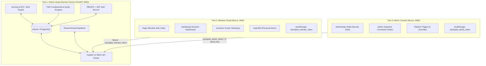

# StockPilot PH v2.0 — Session Handoff & Architecture Document

**Date:** November 5, 2026  
**Active Branch:** `v2-rebuild` (Commit: `6a718b7`)  
**Workspace Root:** `c:\Users\jordsofthejungle\Documents\Projects\pse-quant-saas`  

---

## 1. System Vision & Architectural Split

The platform has been rebuilt into **three decoupled subsystems**:



### Core Architecture Mandates
1. **Part 1 — The Backend / Decision Server (`/backend`):**
   - Single source of truth. All financial scraping, scoring models, Margin of Safety (MoS) discount calculations, customer data, and email alerts run here.
   - Built with **Python 3.12**, **FastAPI**, **SQLAlchemy 2.0**, and **Pydantic v2**.
2. **Part 2 — Customer Facing Member Dashboard (`/frontend`):**
   - Accessible at `/login` and `/dashboard`.
   - UI/UX: Investor-grade dark slate/navy theme, ranking screeners, intrinsic valuation breakdown, and pre-market email digest preferences.
3. **Part 3 — Admin Facing Operator Console (`/frontend`):**
   - Accessible at `/admin/login` and `/admin`.
   - UI/UX: High-security carbon/crimson command console with live server telemetry, manual financial overrides, customer registry, and real-time pipeline run triggers.

### Strict Scope Constraints Enforced
- **No Discord:** All community alert code removed. Replaced with verified direct email alerts via **Resend**.
- **No PayMongo:** Deferred/removed.
- **Strict Portal Isolation:** Admin and Member login pages, layouts, token storage, and backend routes are completely decoupled.

---

## 2. Authentication & Role-Based Gate Separation

### Backend API Security (`backend/pse_quant/api/auth.py` & `routes/auth.py`)

| Endpoint | Purpose | Access Control |
| :--- | :--- | :--- |
| `POST /api/v1/auth/member/login` | Retail investor login | Returns JWT for valid member/admin |
| `POST /api/v1/auth/member/register` | New investor signup | Creates `role='member'` user and returns JWT |
| `POST /api/v1/auth/admin/login` | **Admin operator gate** | **Strict check: requires `role == 'admin'`. Rejects members with `403 Forbidden`** |
| `POST /api/v1/auth/admin/provision` | Initial bootstrap | Requires `ADMIN_MASTER_KEY` (`stockpilot-admin-master-2026`) |
| `GET /api/v1/auth/me` | Current user info | Requires valid Bearer JWT |
| `/api/v1/admin/*` | All operator controls | Protected by `Depends(require_admin)` |

### Frontend Separation (`frontend/src/`)

- **Member Navigation (`components/Navbar.tsx`):** Zero admin console links. Shows member user pill with tier badge and Sign Out button. Hides completely when inside `/admin/*`.
- **Member Login (`app/login/page.tsx`):** Blue/indigo investor theme with Sign In / Register tabs and 1-click test credentials. Saves to `stockpilot_member_token`.
- **Admin Layout (`app/admin/layout.tsx`):** Scoped exclusively to `/admin/*`. Has client-side route guard redirecting unauthenticated users to `/admin/login`. Includes live server telemetry (`127.0.0.1:8000 ONLINE`), operator clearance badge, and "Lock Console" session termination.
- **Admin Login Gate (`app/admin/login/page.tsx`):** Stark carbon/crimson interface with security warning disclaimers. If a member account logs in, it shows: *"ACCESS VIOLATION: CLEARANCE DENIED — Account lacks System Administrator clearance."* Saves to `stockpilot_admin_token`.

---

## 3. Seeded Test Credentials

The local database (`backend/pse_quant/db/pse_local.db`) has been initialized with the following verified credentials:

| Identity | Email | Password | Role / Clearance | Expected Behavior |
| :--- | :--- | :--- | :--- | :--- |
| **System Admin** | `admin@stockpilot.ph` | `AdminPass123!` | `admin` | Logs in at `/admin/login` → unlocks `/admin` |
| **Retail Member** | `member@investor.ph` | `MemberPass123!` | `member` (Tier: `pro`) | Logs in at `/login` → routes to `/dashboard`. Blocked at `/admin/login` with 403 Forbidden |
| **Admin Master Key** | — | `stockpilot-admin-master-2026` | Master Bypass | Used for initial bootstrap or CLI root operations |

---

## 4. Current Daemon Tasks & Services

Both services are currently running in the background:

| Task ID | Description | Address | Command |
| :--- | :--- | :--- | :--- |
| `task-836` | **FastAPI Quant Decision Server** | `http://127.0.0.1:8000` | `cd backend; python -m pse_quant.cli serve --port 8000 --host 127.0.0.1` |
| `task-904` | **Next.js 16 Web Portal** | `http://localhost:3000` | `cd frontend; npm.cmd start` |

To restart or inspect tasks:
- `python -m pse_quant.cli serve --port 8000 --host 127.0.0.1`
- `cd frontend; npm.cmd run build && npm.cmd start`

---

## 5. Verification & Test Suite Status

1. **Backend Tests:**
   - Command: `cd backend; python -m pytest`
   - Results: **76 passed in 3.17s (100% green)**
   - Coverage: Multi-factor scoring, DCF / Margin of Safety, 3-statement unit validation, sector groups, Resend email digest, auth service, and admin API security route guards.

2. **Frontend Build:**
   - Command: `cd frontend; npm.cmd run build`
   - Results: **Compiled successfully with Turbopack (zero TypeScript or Next.js build errors)**
   - Routes:
     - `○ /` (Landing Page)
     - `○ /login` (Member Sign In / Register)
     - `○ /dashboard` (Member Command Center + `<MemberGreeting />`)
     - `○ /screener` (Quantitative Rankings Screener)
     - `○ /watchlist` (Personal Investor Watchlist)
     - `○ /admin/login` (Admin Security Gate)
     - `○ /admin` (Admin Operations Console)
     - `● /stocks/[ticker]` (SSG routes for DMC, AREIT, ICT, SMPH, BDO, etc.)
     - `ƒ /api/*` (Proxy API endpoints)

3. **Live Gateway Verification:**
   - `POST /api/v1/auth/member/login` with `member@investor.ph` → `200 OK`
   - `POST /api/v1/auth/admin/login` with `admin@stockpilot.ph` → `200 OK`
   - `POST /api/v1/auth/admin/login` with `member@investor.ph` → **`403 Forbidden`**
   - Unauthenticated `GET /admin` → client redirect to `/admin/login`

---

## 6. Project Directory Map

```text
pse-quant-saas/
├── backend/
│   ├── pse_quant/
│   │   ├── api/
│   │   │   ├── auth.py              # JWT bearer dependencies & require_admin guard
│   │   │   ├── main.py              # FastAPI app registration & CORS
│   │   │   └── routes/
│   │   │       ├── admin.py         # Protected admin orchestration endpoints
│   │   │       ├── auth.py          # Member & admin login/register/provision routes
│   │   │       ├── email.py         # Resend email digest dispatch routes
│   │   │       └── stocks.py        # Public/member rankings and valuation routes
│   │   ├── core/                    # Quant models (DCF, Graham, sector weights, MoS)
│   │   ├── db/
│   │   │   ├── models.py            # Declarative SQLAlchemy models (User, Stock, etc.)
│   │   │   └── pse_local.db         # Active SQLite test database
│   │   ├── scrapers/                # Fundamental 3-statement & daily quote scrapers
│   │   └── services/
│   │       ├── auth_service.py      # Password hashing, JWT creation & role verification
│   │       └── pipeline_service.py  # Orchestration service for scrapers and models
│   └── tests/                       # 76 passing pytest unit tests
│
├── frontend/
│   ├── src/
│   │   ├── app/
│   │   │   ├── admin/
│   │   │   │   ├── layout.tsx       # Dedicated operator layout & route guard
│   │   │   │   ├── login/page.tsx   # Restricted Admin Gateway page
│   │   │   │   └── page.tsx         # Operational Command Console
│   │   │   ├── dashboard/page.tsx   # Member Command Center
│   │   │   ├── login/page.tsx       # Member Sign In & Registration page
│   │   │   ├── screener/page.tsx    # Rankings Screener
│   │   │   ├── stocks/[ticker]/     # Individual Stock Deep Dive
│   │   │   └── watchlist/page.tsx   # Investor Watchlist
│   │   ├── components/
│   │   │   ├── MemberGreeting.tsx   # Personalized member welcome banner
│   │   │   ├── Navbar.tsx           # Consumer navbar (no admin links)
│   │   │   ├── Footer.tsx           # Consumer footer (hidden on /admin)
│   │   │   └── ScreenerTable.tsx    # Multi-factor ranking table
│   │   └── lib/
│   │       └── api.ts               # Unified API client (stockApi, authApi, adminApi)
│   └── package.json
└── HANDOFF.md                       # Workspace copy of this handoff
```

---

## 7. Immediate Next Steps for Next Session

1. **Watchlist API Sync for Logged-In Members:**
   - Wire `frontend/src/app/watchlist/page.tsx` to save watchlists directly to the backend `Watchlist` table (`/api/v1/watchlist`) using `stockpilot_member_token`, replacing local-only state.
2. **Scheduled Automated Execution (Cron / Automation):**
   - Set up scheduled daily quotes sync (e.g. at 16:00 PHT after PSE market close) and morning pre-market email broadcast (e.g. at 08:30 PHT).
3. **Weekly PDF Report Generation:**
   - Integrate ReportLab to auto-generate the weekly quantitative PDF report attachment for emails sent via Resend.
4. **PSE Edge-Case Scraper Hardening:**
   - Expand the live parser to handle new quarterly financial disclosures and edge cases for small-cap equities.
