# StockPilot PH v2.0 — Session Handoff & Architecture Document

**Date:** November 5, 2026  
**Active Branch:** `v2-rebuild`  
**Workspace Root:** `c:\Users\jordsofthejungle\Documents\Projects\pse-quant-saas`  

---

## 1. System Vision & Architectural Split

The platform is organized into **three decoupled subsystems**:

```mermaid
flowchart TD
    subgraph Part1["Part 1: Python Quant Decision Server (FastAPI :8000)"]
        direction TB
        DB[(SQLite / PostgreSQL)]
        Engine[Scoring & DCF / MoS Engine]
        Scrapers[PSE Fundamental & Quote Scrapers]
        Auth[PBKDF2 + JWT Auth Service]
        Scheduler[Automated PHT Scheduler]
        Resend[Resend Email Dispatcher]
        API[FastAPI v1 REST API Router]
        
        DB <--> API
        Engine <--> DB
        Scrapers --> DB
        Auth <--> DB
        Scheduler --> DB
        Scheduler --> Resend
        Resend <--> API
    end

    subgraph Part2["Part 2: Member Portal (Next.js :3000)"]
        direction TB
        MLogin["/login (Member Auth Gate)"]
        MDash["/dashboard (Investor Dashboard)"]
        MScreen["/screener (Factor Rankings)"]
        MWay["/watchlist (Cloud-Synced Alerts)"]
        MToken["localStorage: stockpilot_member_token"]
    end

    subgraph Part3["Part 3: Admin Console (Next.js :3000)"]
        direction TB
        ALogin["/admin/login (High-Security Gate)"]
        ADash["/admin (Operator Command Center)"]
        AControls["Pipeline Triggers & Overrides"]
        AToken["localStorage: stockpilot_admin_token"]
    end

    Part2 -- "Bearer stockpilot_member_token" --> API
    Part3 -- "Bearer stockpilot_admin_token / X-Admin-Key" --> API
```



### Core Architecture Mandates
1. **Part 1 — The Backend / Decision Server (`/backend`):**
   - Single source of truth. All financial scraping, scoring models, Margin of Safety (MoS) discount calculations, customer data, automated scheduling, and email alerts run here.
   - Built with **Python 3.12**, **FastAPI**, **SQLAlchemy 2.0**, and **Pydantic v2**.
2. **Part 2 — Customer Facing Member Dashboard (`/frontend`):**
   - Accessible at `/login`, `/dashboard`, and `/watchlist`.
   - UI/UX: Investor-grade dark slate/navy theme, ranking screeners, intrinsic valuation breakdown, and cloud-synced Margin of Safety watchlist cushions.
3. **Part 3 — Admin Facing Operator Console (`/frontend`):**
   - Accessible at `/admin/login` and `/admin`.
   - UI/UX: High-security carbon/crimson command console with live server telemetry, manual financial overrides, customer registry, and real-time pipeline run triggers.

---

## 2. Completed Milestones (Current Session)

### 1. Watchlist API Sync for Logged-In Members (`/api/v1/watchlist`)
- **Backend Router:** Created `backend/pse_quant/api/routes/watchlist.py` with authenticated `GET`, `POST`, and `DELETE` endpoints.
- **Access Control:** Requires valid Bearer JWT (`Depends(get_current_user)`). Automatically scopes all queries to `current_user.id`.
- **Frontend Integration:** Added `watchlistApi` in `frontend/src/lib/api.ts` using `getMemberHeaders()` to attach `stockpilot_member_token`.
- **UI Enhancements:** Redesigned `frontend/src/app/watchlist/page.tsx` with live cloud-sync, custom target MoS % input, investment rationale notes, real-time alert trigger indicators, and an unauthenticated guest warning banner.

### 2. Scheduled Automated Execution Engine (`pse_quant.scheduler`)
- **Philippine Standard Time (PHT, UTC+8) Scheduling:**
  - **16:00 PHT (Mon-Fri):** Post-market close PSE stock quote refresh and 3-layer quantitative scoring recalculation.
  - **08:30 PHT (Mon-Fri):** Pre-market member watchlist evaluation and Margin of Safety target alerts dispatch.
  - **08:00 PHT (Mondays):** Executive weekly quantitative ReportLab PDF compilation and subscriber email broadcast.
- **CLI Commands:**
  - `python -m pse_quant.cli schedule-run --job <quotes_sync|morning_alerts|weekly_report>`
  - `python -m pse_quant.cli schedule-daemon [--interval 60]`

### 3. Weekly PDF Report Generation & Resend Integration
- Harmonized `generate_pdf_report()` in `backend/pse_quant/reporting/generator.py` with `send_weekly_report()` in `backend/pse_quant/email/sender.py` and `CustomerService.dispatch_weekly_digest()`.
- Standardized parameter signatures, flexible kwargs handling, base64 PDF attachment encoding, and database `EmailLog` telemetry.

### 4. PSE Edge-Case Scraper Hardening
- Enhanced `backend/pse_quant/scraper/financials.py`:
  - **Unit Detection:** Stricter detection for `in PHP '000`, `Amounts in PHP Thousands`, `exact pesos`, `PHP millions`, and `billions`.
  - **Fiscal Period Matching:** Support for `Period Ended`, `For the Quarter Ended`, `As of Dec 31, 2024`, and non-December fiscal years.
  - **Column Headers:** Automatic extraction of explicit comparative years from table header cells (e.g. `2024` and `2023`) even when standard "current year" wording is omitted.
  - **Field Mapping:** Expanded aliases for `net sales`, `sale of goods`, `operating revenues`, `net income for the period`, `total stockholders equity`, `interest-bearing debt`, and `basic eps`.

---

## 3. Seeded Test Credentials

The local database (`backend/pse_quant/db/pse_local.db`) has been initialized with the following verified credentials:

| Identity | Email | Password | Role / Clearance | Expected Behavior |
| :--- | :--- | :--- | :--- | :--- |
| **System Admin** | `admin@stockpilot.ph` | `AdminPass123!` | `admin` | Logs in at `/admin/login` → unlocks `/admin` |
| **Retail Member** | `member@investor.ph` | `MemberPass123!` | `member` (Tier: `pro`) | Logs in at `/login` → routes to `/dashboard` & `/watchlist`. Blocked at `/admin/login` with 403 Forbidden |
| **Admin Master Key** | — | `stockpilot-admin-master-2026` | Master Bypass | Used for initial bootstrap or CLI root operations |

---

## 4. Current Daemon Tasks & Services

Both services are active in the background:

| Task ID | Description | Address | Command | Status |
| :--- | :--- | :--- | :--- | :--- |
| `task-174` | **FastAPI Quant Decision Server** | `http://127.0.0.1:8000` | `cd backend; python -m pse_quant.cli serve --port 8000 --host 127.0.0.1` | **ONLINE** |
| `task-176` | **Next.js 16 Web Portal** | `http://localhost:3000` | `cd frontend; npm.cmd start` | **ONLINE** |

---

## 5. Verification & Test Suite Status

1. **Backend Tests:**
   - Command: `cd backend; python -m pytest`
   - Results: **86 passed in 3.16s (100% green)**
   - Test files:
     - `tests/test_watchlist.py`: Authenticated CRUD, JWT header verification, MoS target triggers.
     - `tests/test_scheduler.py`: PHT timezone calculation, quotes sync, morning alerts, weekly report.
     - `tests/test_scraper.py`: Small-cap edge cases, period-ended disclosures, unit multipliers.
     - `tests/test_services.py`: Customer lifecycle, watchlist triggers, weekly digest PDF delivery.
     - `tests/test_auth.py`, `tests/test_api.py`, `tests/test_scoring.py`, `tests/test_mos.py`, `tests/test_validator.py`, `tests/test_filters.py`, `tests/test_sector_groups.py`.

2. **Frontend Build:**
   - Command: `cd frontend; npm.cmd run build`
   - Results: **Compiled successfully with Turbopack (zero errors)**
   - Routes:
     - `○ /` (Landing Page)
     - `○ /login` (Member Sign In / Register)
     - `○ /dashboard` (Member Command Center + `<MemberGreeting />`)
     - `○ /screener` (Quantitative Rankings Screener)
     - `○ /watchlist` (Cloud-Synced Member Watchlist)
     - `○ /admin/login` (Admin Security Gate)
     - `○ /admin` (Admin Operations Console)
     - `● /stocks/[ticker]` (SSG routes for DMC, AREIT, ICT, SMPH, BDO, etc.)
     - `ƒ /api/*` (Proxy API endpoints)

3. **Live Gateway & API Verification:**
   - `GET /health` → `200 OK`
   - `POST /api/v1/auth/member/login` with `member@investor.ph` → `200 OK`
   - `POST /api/v1/watchlist` with `AREIT` → `200 OK` (target MoS: 20%)
   - `GET /api/v1/watchlist` → `200 OK` (AREIT: Price=36.5, Intrinsic=46.84, MoS=22.1%, Triggered=True)
   - `DELETE /api/v1/watchlist/AREIT` → `200 OK` (removed)
   - `GET http://localhost:3000/watchlist` → `200 OK`

---

## 6. Project Directory Map

```text
pse-quant-saas/
├── backend/
│   ├── pse_quant/
│   │   ├── api/
│   │   │   ├── auth.py              # JWT bearer dependencies & require_admin guard
│   │   │   ├── main.py              # FastAPI app registration & CORS
│   │   │   └── routes/
│   │   │       ├── admin.py         # Protected admin orchestration endpoints
│   │   │       ├── auth.py          # Member & admin login/register/provision routes
│   │   │       ├── customers.py     # Customer management endpoints
│   │   │       ├── stocks.py        # Public/member rankings and valuation routes
│   │   │       └── watchlist.py     # Authenticated member watchlist endpoints
│   │   ├── core/                    # Quant models (DCF, Graham, sector weights, MoS)
│   │   ├── db/
│   │   │   ├── models.py            # Declarative SQLAlchemy models (User, Stock, etc.)
│   │   │   └── pse_local.db         # Active SQLite test database
│   │   ├── email/
│   │   │   └── sender.py            # Resend email dispatcher & ReportLab PDF attachment
│   │   ├── reporting/
│   │   │   └── generator.py         # ReportLab A4 PDF generator
│   │   ├── scheduler.py             # PHT market hours automated job scheduler
│   │   ├── scrapers/                # Fundamental 3-statement & daily quote scrapers
│   │   └── services/
│   │       ├── auth_service.py      # Password hashing, JWT creation & role verification
│   │       ├── customer_service.py  # Customer life-cycle, watchlists & digest distribution
│   │       └── stock_service.py     # Quotes scraping, scoring models & manual overrides
│   └── tests/                       # 86 passing pytest unit tests
│
├── frontend/
│   ├── src/
│   │   ├── app/
│   │   │   ├── admin/
│   │   │   │   ├── layout.tsx       # Dedicated operator layout & route guard
│   │   │   │   ├── login/page.tsx   # Restricted Admin Gateway page
│   │   │   │   └── page.tsx         # Operational Command Console
│   │   │   ├── dashboard/page.tsx   # Member Command Center
│   │   │   ├── login/page.tsx       # Member Sign In & Registration page
│   │   │   ├── screener/page.tsx    # Rankings Screener
│   │   │   ├── stocks/[ticker]/     # Individual Stock Deep Dive
│   │   │   └── watchlist/page.tsx   # Authenticated & Cloud-Synced Member Watchlist
│   │   ├── components/
│   │   │   ├── MemberGreeting.tsx   # Personalized member welcome banner
│   │   │   ├── Navbar.tsx           # Consumer navbar (no admin links)
│   │   │   ├── Footer.tsx           # Consumer footer (hidden on /admin)
│   │   │   └── ScreenerTable.tsx    # Multi-factor ranking table
│   │   └── lib/
│   │       └── api.ts               # Unified API client (stockApi, authApi, watchlistApi, adminApi)
│   └── package.json
└── HANDOFF.md                       # Workspace copy of this handoff
```

---

## 7. Immediate Next Steps for Next Session

1. **Production Deployment & Dockerization:**
   - Package the FastAPI service and Next.js frontend into containerized Dockerfiles with multi-stage production builds and docker-compose orchestration.
2. **PostgreSQL Production Migration:**
   - Point `DATABASE_URL` from the local SQLite test database (`pse_local.db`) to a managed PostgreSQL instance and execute schema migrations.
3. **Resend Production Domain Verification:**
   - Set up verified DKIM/SPF DNS records on `stockpilot.ph` for production delivery of weekly PDF digests and real-time MoS alerts.
4. **PSE Edge Live Scraper Proxy / Headless Pool:**
   - For high-concurrency production runs across all 280+ PSE equities, integrate proxy rotation or headless browser pooling to prevent rate-limiting during periodic 17-A/17-Q scraping cycles.
