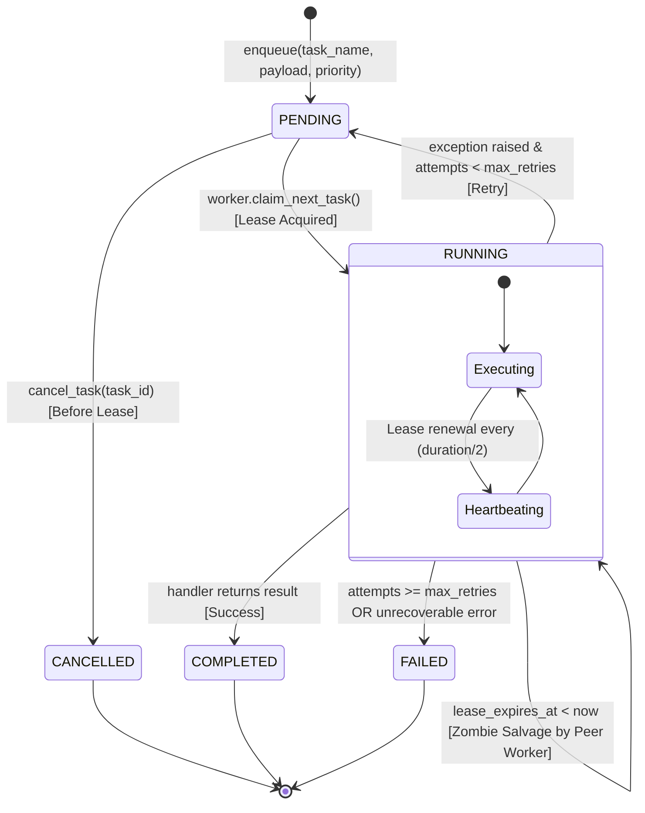

# PSE Quant SaaS — Declarative Contracts & Test Specs

This document defines the immutable schemas, payload structures, calculation boundaries, and Golden Test specifications for `pse-quant-saas`.

---

## 1. Market Data & Financial Statement Ingestion Contracts

### A. Stock Quote & Trading Ingestion
Every ingested stock quote record must conform to this schema:
```json
{
  "ticker": "ALI",
  "trade_date": "2026-11-07",
  "open": 31.00,
  "high": 31.50,
  "low": 30.80,
  "close": 31.00,
  "volume": 12500000,
  "value": 387500000.0,
  "net_foreign": -15200000.0,
  "market_cap": 465000000000.0
}
```

### B. Audited Financial Statement Ingestion (PSE Edge)
Annual and quarterly financial disclosures extracted from official PSE Edge filings must adhere to this structured schema:
```json
{
  "ticker": "AREIT",
  "year": 2024,
  "period": "FY",
  "revenue": 8100.0,
  "operating_income": 5800.0,
  "net_income": 5300.0,
  "eps": 2.92,
  "dps": 2.58,
  "operating_cf": 5500.0,
  "capex": 600.0,
  "total_assets": 75000.0,
  "total_debt": 15550.0,
  "equity": 43200.0
}
```

---

## 2. Quant & Fundamental Valuation Calculation Boundary Contract

### Boundary Rule:
The Quant Core (`pse_quant.core`) is composed of **pure, deterministic functions** with zero external network or database dependencies.

### Calculation Invariant:
- **Input**: Immutable dictionary or typed dataclass containing historical financial statements, latest price, and market parameters (BVAL sovereign yield, risk-free rate, equity risk premium).
- **Output**: Typed valuation and scoring object containing:
  - `score`: Float (0.0 to 100.0)
  - `layers`: Sub-scores (`health`, `improvement`, `persistence`)
  - `valuation`: Triangulated intrinsic value (`ddm`, `eps_pe`, `dcf`, `hybrid_raw`)
  - `mos_pct`: Margin of safety percentage
  - `mos_target_price`: Deep-value limit entry target
- **Prohibition**: UI components (Next.js / React) and API transport layers are strictly prohibited from calculating or modifying financial formulas (e.g., DCF discounting, DDM growth caps, ROE, Margin of Safety) inline.

---

## 3. Done-For-You Fact Card Presentation Contract

All customer-facing reports and endpoints must format recommendations into the standardized **4-Part Fact Card + Seasoned Numbers** payload:

```json
{
  "ticker": "AREIT",
  "name": "AREIT, Inc.",
  "sector": "Property",
  "bucket_tag": "PASSIVE_INCOME_CHAMPION",
  "bucket_label": "Option A: Steady Dividend Payer",
  "fact_card": {
    "verdict": "Clear decision badge and plainspoken Taglish business summary.",
    "peso_value_test": "Price paid per ₱1.00 of true business value vs. Blended Fair Value.",
    "net_dividend_per_10k": "Annual net cash dividends after 10% tax vs. 0.25% bank savings.",
    "health": "Profitability (ROE), capital structure (D/E), and key business risk."
  },
  "seasoned_numbers": {
    "composite_score": 73.0,
    "health_score": 87.2,
    "improvement_score": 97.5,
    "persistence_score": 90.0,
    "current_price_php": 36.50,
    "intrinsic_value_php": 46.84,
    "margin_of_safety_pct": 22.1,
    "net_dividend_yield_pct": 6.36,
    "net_annual_cash_per_10k_php": 636.0,
    "mos_target_price_php": 32.79,
    "ddm_value_php": 42.47,
    "pe_value_php": 38.20,
    "dcf_value_php": 59.24
  }
}
```

---

## 4. Golden Dataset Math Lock Test Spec

### Objective:
Prevent silent mathematical regressions, floating-point drift, and formula mutations across releases.

### Test Mechanics:
- **Fixture File**: `backend/tests/fixtures/golden_pse_records.json` (frozen snapshot of audited company statements and quote histories).
- **Assertion Rule**: When CI/pytest executes the scoring and valuation engine against the golden dataset:
  1. `score` must match the reference value to $\pm 0.05$ points.
  2. `intrinsic_value` and `mos_pct` must match reference values to $\pm 0.01$.
  3. Valuation component blends (`ddm`, `eps_pe`, `dcf`) must match reference hashes down to 4 decimal places.
- **Drift Failure**: Any unintended formula modification will immediately fail the test suite, preventing accidental deployments.

---

## 5. Asynchronous Payment Webhook & Idempotency Contract

### Objective:
Handle real-world payment gateway webhooks (PayMongo, Maya, GCash, Stripe) under at-least-once delivery semantics without duplicate fulfillments, replay exploits, or timeout drops.

### Gateway Transport Invariants:
1. **Cryptographic Signature Verification**:
   - Every inbound webhook must carry a valid HMAC SHA-256 signature in headers (`Paymongo-Signature` or `X-Signature`).
   - Constant-time verification (`hmac.compare_digest`) must execute BEFORE parsing JSON bodies or accessing database records.
   - Any unauthenticated or tampered request must be rejected immediately with `HTTP 401 Unauthorized`.
2. **Sub-50ms Fast-ACK Rule**:
   - The HTTP handler (`POST /api/v1/payments/webhook`) must acknowledge the gateway with `HTTP 200` in $< 50\text{ms}$.
   - Heavy tasks (PDF report compilation via ReportLab and email transmission via Resend SMTP) MUST NEVER execute on the main HTTP request thread. They are scheduled onto `FastAPI.BackgroundTasks` or an asynchronous queue.
3. **Relational Idempotency Lock**:
   - Key: `(provider, event_id)` backed by unique database constraint.
   - Status state machine: `pending` $\to$ `processed` (or `failed`).
   - If a duplicate event arrives (e.g. gateway retry during network jitter), the system detects the existing record, acknowledges with `HTTP 200 {"idempotent": true}`, and suppresses duplicate fulfillment.

---

## 6. Multi-Tier Token Bucket Rate Limiting & IETF Header Contract

### Objective:
Protect calculation endpoints against Denial-of-Service (DoS) and bot scraping while eliminating the fixed-window boundary spike vulnerability.

### Tier Quota Matrix:
| Tier | Burst Capacity ($C$) | Refill Rate ($r$) | Sustained Throughput | Target Client Profile |
| :--- | :--- | :--- | :--- | :--- |
| **Anonymous** | 20 tokens | 0.5 tokens/sec | 30 req/min | Unauthenticated public visitors (Client IP) |
| **Free Member** | 60 tokens | 1.0 tokens/sec | 60 req/min | Registered free members (JWT Bearer) |
| **Paid Customer** | 300 tokens | 5.0 tokens/sec | 300 req/min | PWYC ₱49+ or monthly subscribers (JWT Bearer) |
| **Administrator** | 1000 tokens | 50.0 tokens/sec | 3000 req/min | Master key or Admin JWT (`X-Admin-Key`) |

### Standard RFC 6585 / IETF Headers:
Every API response from non-exempt routes must include:
- `X-RateLimit-Limit`: Maximum burst capacity for the client's tier.
- `X-RateLimit-Remaining`: Floor integer of remaining available tokens.
- `X-RateLimit-Reset`: Estimated seconds until the bucket is completely full.
- `X-RateLimit-Tier`: The resolved tier name (`anonymous`, `free`, `paid`, `admin`).

### Throttled Response Specification:
When a client exhausts their token bucket, the server immediately halts processing with `HTTP 429 Too Many Requests`:
```json
{
  "error": "TooManyRequests",
  "message": "Rate limit exceeded for tier 'anonymous'. Bucket capacity depleted.",
  "tier": "anonymous",
  "burst_capacity": 20,
  "retry_after_seconds": 2.5,
  "path": "/api/v1/reports/done-for-you"
}
```
**Mandatory Header**: `Retry-After: <seconds_until_next_token_available>`


---

## 7. Scraper ETL Resiliency, Circuit Breaker & Dead-Letter Queue Contract

### Objective:
Protect backend ingestion workers against upstream outages (PSE Edge 502/503/504 errors) and prevent malformed, corrupt company disclosures ("poison pills") from aborting batch pipeline execution.

### A. Circuit Breaker State Machine Contract:
- **Scope**: Network interactions with `edge.pse.com.ph` inside `PseEdgeClient`.
- **States**:
  - `CLOSED`: Normal operation. Inbound requests execute normally.
  - `OPEN`: Tripped after 5 consecutive upstream 5xx or connection timeout failures. All subsequent requests fail fast in $< 1\text{ms}$ with zero network overhead.
  - `HALF_OPEN`: Entered after 30-second cooldown expires. Executes a single canary probe. If successful, resets to `CLOSED`. If failed, re-trips immediately to `OPEN`.
- **Exclusion**: HTTP 404 (non-existent ticker) is a client error and must NOT count toward circuit breaker failure thresholds.

### B. Full Jitter Exponential Backoff Specification:
To eliminate the 'thundering herd' retry synchronization against PSE Edge:
$$\text{delay} = \text{random.uniform}(0, \min(\text{max\_delay}, \text{base\_delay} \times 2^{\text{attempt}}))$$
- Base delay: $2.0\text{s}$
- Max delay cap: $30.0\text{s}$

### C. Dead-Letter Queue (DLQ) Ledger Contract:
When a ticker's filing contains unparseable HTML, corrupt date fields, or missing mandatory financial keys:
1. The exception is quarantined into the `scraper_dead_letters` table:
   - `ticker`: Stock ticker
   - `stage`: `directory`, `quote`, `financials`, `validation`
   - `source_url`: Failing request path
   - `error_reason`: Exception message and stack trace
   - `status`: `pending`
2. The outer ETL batch catches the dead letter and continues to the remaining tickers without crashing.
3. Operators can inspect and resolve poison pills via `/api/v1/admin/dead-letters`.


---

## 8. Multi-Tier Cache-Aside & Automated Invalidation Contract

### Objective:
Eliminate redundant database queries and repeated 3-model intrinsic valuation calculations for static read traffic while guaranteeing immediate consistency upon new scraping disclosures.

### A. Cache-Aside Boundary Invariant:
1. **L1 In-Memory Fast Path**:
   - Keys:
     - `stock:profile:{ticker}`: Deep-dive profile payload (TTL: 300s).
     - `stock:rankings:{portfolio}:{sector}:{min_score}:{min_mos}:{limit}`: Screener ranking query (TTL: 300s).
     - `report:done-for-you:{goal}:{ticker}`: Fact Card presentation payload (TTL: 300s).
   - Read latency: $< 0.1\text{ms}$ on cache hit.
2. **Single-Flight Stampede Mutex (Dog-Piling Lock)**:
   - When an entry expires under high concurrency, only ONE thread acquires the per-key mutex to query the database and recompute the valuation models.
   - All concurrent threads wait on the mutex and read the resulting cached value once populated, preventing database connection pool exhaustion.
3. **TTL Jitter Contract**:
   - Every cached entry must apply a $\pm 15\%$ random jitter to the base TTL:
     $$\text{TTL}_{\text{actual}} = \text{max}(1.0, \text{TTL}_{\text{base}} + \text{random.uniform}(-0.15 \times \text{TTL}_{\text{base}}, +0.15 \times \text{TTL}_{\text{base}}))$$
   - Prevents simultaneous expiration cascades across hundreds of listed equities.

### B. Automated Invalidation Hooks:
1. **ETL Pipeline Invalidation**:
   - When `sync_stock_quotes` or `sync_financials` completes: invalidates `stock:profile:*` and `stock:rankings:*`.
   - When `compute_scores_and_rankings` completes: invalidates `stock:*` and `report:*`.
2. **Admin Override Invalidation**:
   - Manually overriding a stock's financials (`override_financial_data`) immediately purges `stock:profile:{ticker}` and `stock:rankings:*`.


---

## 9. Event-Driven Portfolio Alerts & Pub-Sub Fanout Contract

### Objective:
Decouple quant calculation and market ingestion from customer notification pipelines, eliminating database polling and guaranteeing deduplicated alert delivery.

### A. Domain Event Schemas:
1. **`QuantValuationEvent`**:
   - Topic: `quant.valuation.{TICKER}`
   - Fields: `ticker`, `price`, `intrinsic_value`, `mos_pct`, `score`, `category`, `timestamp`
2. **`MarketTickEvent`**:
   - Topic: `market.tick.{TICKER}`
   - Fields: `ticker`, `price`, `volume`, `change_pct`, `timestamp`

### B. Fanout & Predicate Filtering Rules:
When an event fires, `AlertFanoutService`:
1. Queries all active watchlists matching `ticker`.
2. Verifies user status is active and `notification_prefs["price_alerts"] == True`.
3. Verifies `event.mos_pct >= watchlist.target_mos_pct` (default: 20%).

### C. Anti-Fatigue Deduplication Cooldown Contract:
- Key: `(user_id, ticker, alert_type)`
- Cooldown Window: 4 hours (240 minutes).
- Invariant: If a notification of the same `alert_type` was already generated for that user and ticker within the last 4 hours, subsequent events are suppressed, preventing alert storms on boundary price fluctuations.
- Persistence: Stored in relational `user_notifications` ledger with unread badge tracking.


---

## 10. Database Read Replicas & Connection Pool Tuning Contract

### Objective:
Decouple heavy background batch write workloads (PSE Edge scraping, 10-year statement parsing, batch quant scoring, webhook payment fulfillment) from high-concurrency investor read traffic (stock screeners, ranking lookups, fact cards), eliminating pool starvation, lock contention, and p99 latency degradation.

### A. Dual-Engine & Routing Architecture:
1. **Writer Engine (`pool_manager.writer_engine`)**:
   - URL: Bound to `DATABASE_URL` (or local SQLite file in local development).
   - Session: `pool_manager.WriterSession`.
   - Routing Context: `get_write_session()`, `get_db_session()`, `get_db`.
   - Semantics: Full ACID transactional isolation with automatic commit on success and rollback on exception.
2. **Reader Replica Engine (`pool_manager.reader_engine`)**:
   - URL: Bound to `DATABASE_REPLICA_URL`. If not configured, gracefully falls back to `DATABASE_URL` with an independent read connection pool.
   - Session: `pool_manager.ReaderSession`.
   - Routing Context: `get_read_session()`, `get_read_db`.
   - Semantics: High-throughput read-only queries with zero commit round-trip overhead.

### B. Connection Pool Sizing & Fail-Fast Tuning:
| Parameter | Writer Pool | Reader Replica Pool | Purpose |
| :--- | :--- | :--- | :--- |
| `pool_size` | 15 connections | 25 connections | Dedicated baseline persistent connection capacity. |
| `max_overflow` | 10 connections | 20 connections | Burst capacity for traffic spikes and parallel background jobs. |
| `pool_timeout` | 10.0 seconds | 10.0 seconds | Fail-fast threshold preventing connection hanging during DB saturation. |
| `pool_recycle` | 1800 seconds (30m) | 1800 seconds (30m) | Proactively closes and re-establishes stale connections before DB drops them. |
| `pool_pre_ping` | `True` | `True` | Pessimistic liveness check (`SELECT 1`) eliminating dead connection errors. |

### C. Observability & Telemetry Contract:
- **Metrics Endpoint**: `GET /api/v1/admin/db/pool-metrics` (Admin authorized via `X-Admin-Key` or Admin JWT).
- **Payload Schema**:
  ```json
  {
    "status": "healthy",
    "routing": {
      "read_queries_routed": 1420,
      "write_queries_routed": 85,
      "total_queries_routed": 1505,
      "read_percentage": 94.35,
      "read_replica_configured": true
    },
    "writer_pool": {
      "pool_size": 15,
      "checked_in": 14,
      "checked_out": 1,
      "overflow": 0,
      "active_connections": 1
    },
    "reader_pool": {
      "pool_size": 25,
      "checked_in": 23,
      "checked_out": 2,
      "overflow": 0,
      "active_connections": 2
    },
    "tuning": {
      "writer_pool_size": 15,
      "writer_max_overflow": 10,
      "reader_pool_size": 25,
      "reader_max_overflow": 20,
      "pool_timeout_seconds": 10.0,
      "pool_recycle_seconds": 1800,
      "pool_pre_ping": true
    }
  }
  ```
- **Reset Endpoint**: `POST /api/v1/admin/db/pool-metrics/reset` clears routing counters back to zero.


---

## 11. Distributed Task Queue & Leased Worker Contract

### Objective:
Decouple compute-heavy or network-bound batch operations (278-stock PSE directory sync, 10-year financial statement parsing, quant batch scoring, PDF report compilation, and weekly email digest dispatches) from the synchronous HTTP request-response cycle. Guarantees zero dropped jobs across server restarts through a persistent relational ledger, exclusive worker leases, active heartbeats, and automatic zombie reclamation.

### A. Task State Machine & Transitions:


### B. Worker Lease & Zombie Recovery Protocol:
1. **Atomic Lease Lock**:
   - Workers query candidates using `SELECT ... FOR UPDATE SKIP LOCKED` ordered by `priority DESC, created_at ASC`.
   - Criteria: `status = 'pending'` OR (`status = 'running'` AND `lease_expires_at < UTC_NOW`).
   - Lease Claim: Atomically sets `status = 'running'`, `worker_id = <uuid>`, `attempts += 1`, and `lease_expires_at = UTC_NOW + lease_duration` (30s).
2. **Active Heartbeat Thread**:
   - A dedicated daemon thread renews `lease_expires_at = UTC_NOW + lease_duration` every `lease_duration / 2` seconds while the handler is executing.
   - Prevents healthy long-running tasks (e.g. 2-minute batch PDF compilation) from being mistakenly reclaimed.
3. **Zombie Task Sweeping**:
   - If a worker process abruptly terminates (OOM killer, pod restart, hardware crash), its lease expires without completion.
   - Any surviving peer worker automatically salvages the task, increments attempts, and finishes execution without manual admin intervention.

### C. Registered Task Catalog:
| Task Name | Domain Responsibility | Retry Policy | Default Priority |
| :--- | :--- | :--- | :--- |
| `etl.sync_all` | Full 278-stock sync, quotes, multi-year statements, scoring | 2 retries | 4 (Batch) |
| `etl.scrape_quotes` | Daily PSE Edge price, volume, and dividend refresh | 3 retries | 6 (Operational) |
| `etl.recompute_scores` | Deterministic 3-layer scorer & MoS model valuation | 3 retries | 5 (Normal) |
| `reports.generate_pdf` | Institutional A4 PDF research dossier compilation | 2 retries | 8 (High) |
| `email.dispatch_digest` | Weekly research digest batch email distribution | 3 retries | 7 (High) |
| `test.echo` / `test.fail`| Diagnostic verification, connectivity, and retry testing | 1-3 retries | 5 (Normal) |

### D. Telemetry & Observability Contract:
- **Metrics Endpoint**: `GET /api/v1/tasks/admin/metrics`
  ```json
  {
    "queue_depth": 3,
    "running_tasks": 2,
    "completed_tasks": 142,
    "failed_tasks": 1,
    "cancelled_tasks": 2,
    "total_tasks": 150,
    "failure_rate_pct": 0.67,
    "registered_tasks": [
      "email.dispatch_digest",
      "etl.recompute_scores",
      "etl.scrape_quotes",
      "etl.sync_all",
      "reports.generate_pdf",
      "test.echo",
      "test.fail"
    ]
  }
  ```
