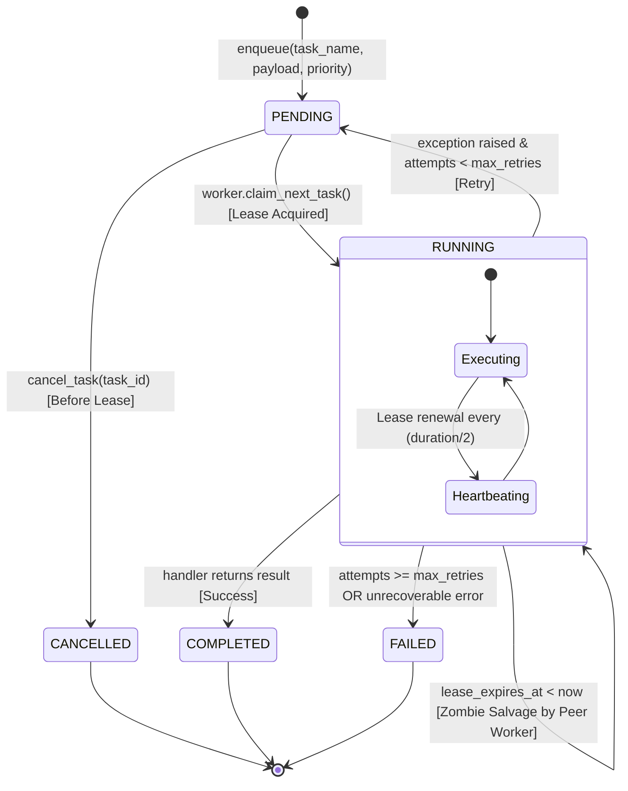
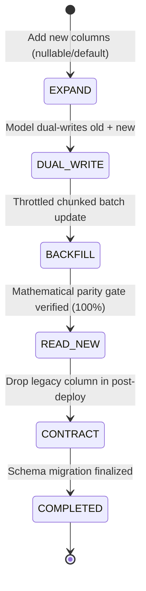

# PSE Quant SaaS — Declarative Contracts & Test Specs

This document defines the immutable schemas, payload structures, calculation boundaries, and Golden Test specifications for `pse-quant-saas`.

---

## 1. Market Data & Financial Statement Ingestion Contracts

### A. Stock Quote & Trading Ingestion
Every ingested stock quote record must conform to this schema:
```json
{
  "ticker": "ALI",
  "trade_date": "2026-11-07",
  "open": 31.00,
  "high": 31.50,
  "low": 30.80,
  "close": 31.00,
  "volume": 12500000,
  "value": 387500000.0,
  "net_foreign": -15200000.0,
  "market_cap": 465000000000.0
}
```

### B. Audited Financial Statement Ingestion (PSE Edge)
Annual and quarterly financial disclosures extracted from official PSE Edge filings must adhere to this structured schema:
```json
{
  "ticker": "AREIT",
  "year": 2024,
  "period": "FY",
  "revenue": 8100.0,
  "operating_income": 5800.0,
  "net_income": 5300.0,
  "eps": 2.92,
  "dps": 2.58,
  "operating_cf": 5500.0,
  "capex": 600.0,
  "total_assets": 75000.0,
  "total_debt": 15550.0,
  "equity": 43200.0
}
```

---

## 2. Quant & Fundamental Valuation Calculation Boundary Contract

### Boundary Rule:
The Quant Core (`pse_quant.core`) is composed of **pure, deterministic functions** with zero external network or database dependencies.

### Calculation Invariant:
- **Input**: Immutable dictionary or typed dataclass containing historical financial statements, latest price, and market parameters (BVAL sovereign yield, risk-free rate, equity risk premium).
- **Output**: Typed valuation and scoring object containing:
  - `score`: Float (0.0 to 100.0)
  - `layers`: Sub-scores (`health`, `improvement`, `persistence`)
  - `valuation`: Triangulated intrinsic value (`ddm`, `eps_pe`, `dcf`, `hybrid_raw`)
  - `mos_pct`: Margin of safety percentage
  - `mos_target_price`: Deep-value limit entry target
- **Prohibition**: UI components (Next.js / React) and API transport layers are strictly prohibited from calculating or modifying financial formulas (e.g., DCF discounting, DDM growth caps, ROE, Margin of Safety) inline.

---

## 3. Done-For-You Fact Card Presentation Contract

All customer-facing reports and endpoints must format recommendations into the standardized **4-Part Fact Card + Seasoned Numbers** payload:

```json
{
  "ticker": "AREIT",
  "name": "AREIT, Inc.",
  "sector": "Property",
  "bucket_tag": "PASSIVE_INCOME_CHAMPION",
  "bucket_label": "Option A: Steady Dividend Payer",
  "fact_card": {
    "verdict": "Clear decision badge and plainspoken Taglish business summary.",
    "peso_value_test": "Price paid per ₱1.00 of true business value vs. Blended Fair Value.",
    "net_dividend_per_10k": "Annual net cash dividends after 10% tax vs. 0.25% bank savings.",
    "health": "Profitability (ROE), capital structure (D/E), and key business risk."
  },
  "seasoned_numbers": {
    "composite_score": 73.0,
    "health_score": 87.2,
    "improvement_score": 97.5,
    "persistence_score": 90.0,
    "current_price_php": 36.50,
    "intrinsic_value_php": 46.84,
    "margin_of_safety_pct": 22.1,
    "net_dividend_yield_pct": 6.36,
    "net_annual_cash_per_10k_php": 636.0,
    "mos_target_price_php": 32.79,
    "ddm_value_php": 42.47,
    "pe_value_php": 38.20,
    "dcf_value_php": 59.24
  }
}
```

---

## 4. Golden Dataset Math Lock Test Spec

### Objective:
Prevent silent mathematical regressions, floating-point drift, and formula mutations across releases.

### Test Mechanics:
- **Fixture File**: `backend/tests/fixtures/golden_pse_records.json` (frozen snapshot of audited company statements and quote histories).
- **Assertion Rule**: When CI/pytest executes the scoring and valuation engine against the golden dataset:
  1. `score` must match the reference value to $\pm 0.05$ points.
  2. `intrinsic_value` and `mos_pct` must match reference values to $\pm 0.01$.
  3. Valuation component blends (`ddm`, `eps_pe`, `dcf`) must match reference hashes down to 4 decimal places.
- **Drift Failure**: Any unintended formula modification will immediately fail the test suite, preventing accidental deployments.

---

## 5. Asynchronous Payment Webhook & Idempotency Contract

### Objective:
Handle real-world payment gateway webhooks (PayMongo, Maya, GCash, Stripe) under at-least-once delivery semantics without duplicate fulfillments, replay exploits, or timeout drops.

### Gateway Transport Invariants:
1. **Cryptographic Signature Verification**:
   - Every inbound webhook must carry a valid HMAC SHA-256 signature in headers (`Paymongo-Signature` or `X-Signature`).
   - Constant-time verification (`hmac.compare_digest`) must execute BEFORE parsing JSON bodies or accessing database records.
   - Any unauthenticated or tampered request must be rejected immediately with `HTTP 401 Unauthorized`.
2. **Sub-50ms Fast-ACK Rule**:
   - The HTTP handler (`POST /api/v1/payments/webhook`) must acknowledge the gateway with `HTTP 200` in $< 50\text{ms}$.
   - Heavy tasks (PDF report compilation via ReportLab and email transmission via Resend SMTP) MUST NEVER execute on the main HTTP request thread. They are scheduled onto `FastAPI.BackgroundTasks` or an asynchronous queue.
3. **Relational Idempotency Lock**:
   - Key: `(provider, event_id)` backed by unique database constraint.
   - Status state machine: `pending` $\to$ `processed` (or `failed`).
   - If a duplicate event arrives (e.g. gateway retry during network jitter), the system detects the existing record, acknowledges with `HTTP 200 {"idempotent": true}`, and suppresses duplicate fulfillment.

---

## 6. Multi-Tier Token Bucket Rate Limiting & IETF Header Contract

### Objective:
Protect calculation endpoints against Denial-of-Service (DoS) and bot scraping while eliminating the fixed-window boundary spike vulnerability.

### Tier Quota Matrix:
| Tier | Burst Capacity ($C$) | Refill Rate ($r$) | Sustained Throughput | Target Client Profile |
| :--- | :--- | :--- | :--- | :--- |
| **Anonymous** | 20 tokens | 0.5 tokens/sec | 30 req/min | Unauthenticated public visitors (Client IP) |
| **Free Member** | 60 tokens | 1.0 tokens/sec | 60 req/min | Registered free members (JWT Bearer) |
| **Paid Customer** | 300 tokens | 5.0 tokens/sec | 300 req/min | PWYC ₱49+ or monthly subscribers (JWT Bearer) |
| **Administrator** | 1000 tokens | 50.0 tokens/sec | 3000 req/min | Master key or Admin JWT (`X-Admin-Key`) |

### Standard RFC 6585 / IETF Headers:
Every API response from non-exempt routes must include:
- `X-RateLimit-Limit`: Maximum burst capacity for the client's tier.
- `X-RateLimit-Remaining`: Floor integer of remaining available tokens.
- `X-RateLimit-Reset`: Estimated seconds until the bucket is completely full.
- `X-RateLimit-Tier`: The resolved tier name (`anonymous`, `free`, `paid`, `admin`).

### Throttled Response Specification:
When a client exhausts their token bucket, the server immediately halts processing with `HTTP 429 Too Many Requests`:
```json
{
  "error": "TooManyRequests",
  "message": "Rate limit exceeded for tier 'anonymous'. Bucket capacity depleted.",
  "tier": "anonymous",
  "burst_capacity": 20,
  "retry_after_seconds": 2.5,
  "path": "/api/v1/reports/done-for-you"
}
```
**Mandatory Header**: `Retry-After: <seconds_until_next_token_available>`


---

## 7. Scraper ETL Resiliency, Circuit Breaker & Dead-Letter Queue Contract

### Objective:
Protect backend ingestion workers against upstream outages (PSE Edge 502/503/504 errors) and prevent malformed, corrupt company disclosures ("poison pills") from aborting batch pipeline execution.

### A. Circuit Breaker State Machine Contract:
- **Scope**: Network interactions with `edge.pse.com.ph` inside `PseEdgeClient`.
- **States**:
  - `CLOSED`: Normal operation. Inbound requests execute normally.
  - `OPEN`: Tripped after 5 consecutive upstream 5xx or connection timeout failures. All subsequent requests fail fast in $< 1\text{ms}$ with zero network overhead.
  - `HALF_OPEN`: Entered after 30-second cooldown expires. Executes a single canary probe. If successful, resets to `CLOSED`. If failed, re-trips immediately to `OPEN`.
- **Exclusion**: HTTP 404 (non-existent ticker) is a client error and must NOT count toward circuit breaker failure thresholds.

### B. Full Jitter Exponential Backoff Specification:
To eliminate the 'thundering herd' retry synchronization against PSE Edge:
$$\text{delay} = \text{random.uniform}(0, \min(\text{max\_delay}, \text{base\_delay} \times 2^{\text{attempt}}))$$
- Base delay: $2.0\text{s}$
- Max delay cap: $30.0\text{s}$

### C. Dead-Letter Queue (DLQ) Ledger Contract:
When a ticker's filing contains unparseable HTML, corrupt date fields, or missing mandatory financial keys:
1. The exception is quarantined into the `scraper_dead_letters` table:
   - `ticker`: Stock ticker
   - `stage`: `directory`, `quote`, `financials`, `validation`
   - `source_url`: Failing request path
   - `error_reason`: Exception message and stack trace
   - `status`: `pending`
2. The outer ETL batch catches the dead letter and continues to the remaining tickers without crashing.
3. Operators can inspect and resolve poison pills via `/api/v1/admin/dead-letters`.


---

## 8. Multi-Tier Cache-Aside & Automated Invalidation Contract

### Objective:
Eliminate redundant database queries and repeated 3-model intrinsic valuation calculations for static read traffic while guaranteeing immediate consistency upon new scraping disclosures.

### A. Cache-Aside Boundary Invariant:
1. **L1 In-Memory Fast Path**:
   - Keys:
     - `stock:profile:{ticker}`: Deep-dive profile payload (TTL: 300s).
     - `stock:rankings:{portfolio}:{sector}:{min_score}:{min_mos}:{limit}`: Screener ranking query (TTL: 300s).
     - `report:done-for-you:{goal}:{ticker}`: Fact Card presentation payload (TTL: 300s).
   - Read latency: $< 0.1\text{ms}$ on cache hit.
2. **Single-Flight Stampede Mutex (Dog-Piling Lock)**:
   - When an entry expires under high concurrency, only ONE thread acquires the per-key mutex to query the database and recompute the valuation models.
   - All concurrent threads wait on the mutex and read the resulting cached value once populated, preventing database connection pool exhaustion.
3. **TTL Jitter Contract**:
   - Every cached entry must apply a $\pm 15\%$ random jitter to the base TTL:
     $$\text{TTL}_{\text{actual}} = \text{max}(1.0, \text{TTL}_{\text{base}} + \text{random.uniform}(-0.15 \times \text{TTL}_{\text{base}}, +0.15 \times \text{TTL}_{\text{base}}))$$
   - Prevents simultaneous expiration cascades across hundreds of listed equities.

### B. Automated Invalidation Hooks:
1. **ETL Pipeline Invalidation**:
   - When `sync_stock_quotes` or `sync_financials` completes: invalidates `stock:profile:*` and `stock:rankings:*`.
   - When `compute_scores_and_rankings` completes: invalidates `stock:*` and `report:*`.
2. **Admin Override Invalidation**:
   - Manually overriding a stock's financials (`override_financial_data`) immediately purges `stock:profile:{ticker}` and `stock:rankings:*`.


---

## 9. Event-Driven Portfolio Alerts & Pub-Sub Fanout Contract

### Objective:
Decouple quant calculation and market ingestion from customer notification pipelines, eliminating database polling and guaranteeing deduplicated alert delivery.

### A. Domain Event Schemas:
1. **`QuantValuationEvent`**:
   - Topic: `quant.valuation.{TICKER}`
   - Fields: `ticker`, `price`, `intrinsic_value`, `mos_pct`, `score`, `category`, `timestamp`
2. **`MarketTickEvent`**:
   - Topic: `market.tick.{TICKER}`
   - Fields: `ticker`, `price`, `volume`, `change_pct`, `timestamp`

### B. Fanout & Predicate Filtering Rules:
When an event fires, `AlertFanoutService`:
1. Queries all active watchlists matching `ticker`.
2. Verifies user status is active and `notification_prefs["price_alerts"] == True`.
3. Verifies `event.mos_pct >= watchlist.target_mos_pct` (default: 20%).

### C. Anti-Fatigue Deduplication Cooldown Contract:
- Key: `(user_id, ticker, alert_type)`
- Cooldown Window: 4 hours (240 minutes).
- Invariant: If a notification of the same `alert_type` was already generated for that user and ticker within the last 4 hours, subsequent events are suppressed, preventing alert storms on boundary price fluctuations.
- Persistence: Stored in relational `user_notifications` ledger with unread badge tracking.


---

## 10. Database Read Replicas & Connection Pool Tuning Contract

### Objective:
Decouple heavy background batch write workloads (PSE Edge scraping, 10-year statement parsing, batch quant scoring, webhook payment fulfillment) from high-concurrency investor read traffic (stock screeners, ranking lookups, fact cards), eliminating pool starvation, lock contention, and p99 latency degradation.

### A. Dual-Engine & Routing Architecture:
1. **Writer Engine (`pool_manager.writer_engine`)**:
   - URL: Bound to `DATABASE_URL` (or local SQLite file in local development).
   - Session: `pool_manager.WriterSession`.
   - Routing Context: `get_write_session()`, `get_db_session()`, `get_db`.
   - Semantics: Full ACID transactional isolation with automatic commit on success and rollback on exception.
2. **Reader Replica Engine (`pool_manager.reader_engine`)**:
   - URL: Bound to `DATABASE_REPLICA_URL`. If not configured, gracefully falls back to `DATABASE_URL` with an independent read connection pool.
   - Session: `pool_manager.ReaderSession`.
   - Routing Context: `get_read_session()`, `get_read_db`.
   - Semantics: High-throughput read-only queries with zero commit round-trip overhead.

### B. Connection Pool Sizing & Fail-Fast Tuning:
| Parameter | Writer Pool | Reader Replica Pool | Purpose |
| :--- | :--- | :--- | :--- |
| `pool_size` | 15 connections | 25 connections | Dedicated baseline persistent connection capacity. |
| `max_overflow` | 10 connections | 20 connections | Burst capacity for traffic spikes and parallel background jobs. |
| `pool_timeout` | 10.0 seconds | 10.0 seconds | Fail-fast threshold preventing connection hanging during DB saturation. |
| `pool_recycle` | 1800 seconds (30m) | 1800 seconds (30m) | Proactively closes and re-establishes stale connections before DB drops them. |
| `pool_pre_ping` | `True` | `True` | Pessimistic liveness check (`SELECT 1`) eliminating dead connection errors. |

### C. Observability & Telemetry Contract:
- **Metrics Endpoint**: `GET /api/v1/admin/db/pool-metrics` (Admin authorized via `X-Admin-Key` or Admin JWT).
- **Payload Schema**:
  ```json
  {
    "status": "healthy",
    "routing": {
      "read_queries_routed": 1420,
      "write_queries_routed": 85,
      "total_queries_routed": 1505,
      "read_percentage": 94.35,
      "read_replica_configured": true
    },
    "writer_pool": {
      "pool_size": 15,
      "checked_in": 14,
      "checked_out": 1,
      "overflow": 0,
      "active_connections": 1
    },
    "reader_pool": {
      "pool_size": 25,
      "checked_in": 23,
      "checked_out": 2,
      "overflow": 0,
      "active_connections": 2
    },
    "tuning": {
      "writer_pool_size": 15,
      "writer_max_overflow": 10,
      "reader_pool_size": 25,
      "reader_max_overflow": 20,
      "pool_timeout_seconds": 10.0,
      "pool_recycle_seconds": 1800,
      "pool_pre_ping": true
    }
  }
  ```
- **Reset Endpoint**: `POST /api/v1/admin/db/pool-metrics/reset` clears routing counters back to zero.


---

## 11. Distributed Task Queue & Leased Worker Contract

### Objective:
Decouple compute-heavy or network-bound batch operations (278-stock PSE directory sync, 10-year financial statement parsing, quant batch scoring, PDF report compilation, and weekly email digest dispatches) from the synchronous HTTP request-response cycle. Guarantees zero dropped jobs across server restarts through a persistent relational ledger, exclusive worker leases, active heartbeats, and automatic zombie reclamation.

### A. Task State Machine & Transitions:


### B. Worker Lease & Zombie Recovery Protocol:
1. **Atomic Lease Lock**:
   - Workers query candidates using `SELECT ... FOR UPDATE SKIP LOCKED` ordered by `priority DESC, created_at ASC`.
   - Criteria: `status = 'pending'` OR (`status = 'running'` AND `lease_expires_at < UTC_NOW`).
   - Lease Claim: Atomically sets `status = 'running'`, `worker_id = <uuid>`, `attempts += 1`, and `lease_expires_at = UTC_NOW + lease_duration` (30s).
2. **Active Heartbeat Thread**:
   - A dedicated daemon thread renews `lease_expires_at = UTC_NOW + lease_duration` every `lease_duration / 2` seconds while the handler is executing.
   - Prevents healthy long-running tasks (e.g. 2-minute batch PDF compilation) from being mistakenly reclaimed.
3. **Zombie Task Sweeping**:
   - If a worker process abruptly terminates (OOM killer, pod restart, hardware crash), its lease expires without completion.
   - Any surviving peer worker automatically salvages the task, increments attempts, and finishes execution without manual admin intervention.

### C. Registered Task Catalog:
| Task Name | Domain Responsibility | Retry Policy | Default Priority |
| :--- | :--- | :--- | :--- |
| `etl.sync_all` | Full 278-stock sync, quotes, multi-year statements, scoring | 2 retries | 4 (Batch) |
| `etl.scrape_quotes` | Daily PSE Edge price, volume, and dividend refresh | 3 retries | 6 (Operational) |
| `etl.recompute_scores` | Deterministic 3-layer scorer & MoS model valuation | 3 retries | 5 (Normal) |
| `reports.generate_pdf` | Institutional A4 PDF research dossier compilation | 2 retries | 8 (High) |
| `email.dispatch_digest` | Weekly research digest batch email distribution | 3 retries | 7 (High) |
| `test.echo` / `test.fail`| Diagnostic verification, connectivity, and retry testing | 1-3 retries | 5 (Normal) |

### D. Telemetry & Observability Contract:
- **Metrics Endpoint**: `GET /api/v1/tasks/admin/metrics`
  ```json
  {
    "queue_depth": 3,
    "running_tasks": 2,
    "completed_tasks": 142,
    "failed_tasks": 1,
    "cancelled_tasks": 2,
    "total_tasks": 150,
    "failure_rate_pct": 0.67,
    "registered_tasks": [
      "email.dispatch_digest",
      "etl.recompute_scores",
      "etl.scrape_quotes",
      "etl.sync_all",
      "reports.generate_pdf",
      "test.echo",
      "test.fail"
    ]
  }
  ```


---

## 12. Distributed Tracing, Correlation IDs & Observability Contract

### Objective:
Unify diagnostic context across all distributed execution boundaries (Next.js presentation layer, API gateway, dual-engine connection pool, cache-aside store, pub-sub alerts, and asynchronous leased workers). Guarantees instantaneous forensic correlation between user requests, database queries, and background worker jobs while tracking rolling p50, p95, and p99 latency quantiles.

### A. HTTP Tracing Header Protocols:
| Header | Ingestion / Egress Rule | Example Format |
| :--- | :--- | :--- |
| `X-Correlation-ID` | Ingested if provided; generated if absent (`corr_<16hex>`). Always reflected in response. | `corr_4a8b1c2d3e4f5a6b` |
| `X-Response-Time-Ms` | Egress only. High-precision monotonic execution duration computed via `time.perf_counter()`. | `4.25ms` |
| `traceparent` | W3C distributed trace standard. TracingMiddleware extracts 16-char trace prefix if `X-Correlation-ID` is missing. | `00-4bf92f3577b34da6a3ce929d0e0e4736-00f067aa0ba902b7-01` |

### B. Ambient Context Propagation & Task Worker Inheritance:
1. **Thread & Async Context**:
   - `correlation_id` is stored in ambient Python `contextvars.ContextVar`.
   - Accessible anywhere via `get_correlation_id()` without passing logger arguments through function signatures.
2. **Asynchronous Worker Handoff**:
   - When `task_queue.enqueue(...)` is invoked during an HTTP request, the active `correlation_id` is automatically stamped into `TaskRecord.payload_json["_correlation_id"]`.
   - When a `TaskWorker` claims the task in a separate background thread, it binds that exact `_correlation_id` into its thread's `ContextVar`.
   - All logs, database queries, and sub-actions executed by the worker share the original user's request trace!

### C. Structured JSON Logging Schema:
```json
{
  "timestamp": "2026-11-08T14:36:00.123456+00:00",
  "level": "INFO",
  "logger": "pse_quant.services.stock",
  "message": "Stock profile query executed",
  "correlation_id": "corr_3a9f02bc14a5d8e7",
  "path": "/api/v1/stocks/ALI",
  "method": "GET",
  "status_code": 200,
  "duration_ms": 8.42,
  "client_ip": "127.0.0.1"
}
```

### D. Latency Percentile Telemetry Schema:
- **Endpoint**: `GET /api/v1/admin/telemetry/latency` (Admin authorized).
- **Payload Structure**:
  ```json
  {
    "overall": {
      "total_requests": 1420,
      "p50_ms": 4.12,
      "p95_ms": 14.85,
      "p99_ms": 28.30,
      "avg_ms": 5.40,
      "min_ms": 0.85,
      "max_ms": 45.10
    },
    "routes": {
      "GET /api/v1/stocks": {
        "count": 850,
        "sample_window_size": 850,
        "p50_ms": 3.90,
        "p95_ms": 11.20,
        "p99_ms": 19.50,
        "avg_ms": 4.60,
        "min_ms": 0.85,
        "max_ms": 22.40
      }
    }
  }
  ```
- **Unified Live Pulse**: `GET /api/v1/admin/telemetry/live` aggregates overall latency, DB connection pool health, cache hit ratios, and task queue depth into a single atomic heartbeat payload.


---

## 13. Real-Time Server-Sent Events (SSE) Streaming Pipeline Contract

### Objective:
Replace inefficient client polling loops with unidirectional, HTTP-native real-time event streaming compliant with the W3C EventSource specification. Guarantees sub-50ms push delivery of background task progress milestones, personalized Margin of Safety portfolio alerts, and live market quotes without WebSockets stateful proxy overhead.

### A. W3C Protocol & Transport Headers:
```http
HTTP/1.1 200 OK
Content-Type: text/event-stream
Cache-Control: no-cache
Connection: keep-alive
X-Accel-Buffering: no
X-Correlation-ID: corr_883a9f02bc14a5d8

id: evt_4a8b1c2d3e4f
event: task_progress
retry: 3000
data: {"task_id": "task_xyz", "progress_pct": 65, "step": "scrape_quotes", "message": "Quotes updated for 278 stocks"}

: ping

```

### B. Streaming Channels & Topology:
| Channel | Target Audience | Emitted Event Types | Producer Source |
| :--- | :--- | :--- | :--- |
| `tasks:{task_id}` | Task initiator / Admin | `task_initial`, `task_progress`, `task_completed`, `task_failed` | `TaskWorker` via `broadcast_task_progress` |
| `alerts:user:{user_id}` | Authenticated Member | `alert_notification`, `mos_breach` | `AlertFanoutService` (Lab 7) |
| `market:ticks` | Public / Dashboard | `tick`, `price_shift`, `volume_surge` | PSE Edge Scraper / Quote Ingest |
| `admin:pulse` | System Admin | `system_pulse`, `queue_metrics` | `StreamHub` Telemetry Generator |

### C. Connection Resiliency & Proxy Invariants:
1. **Heartbeat Keep-Alive**:
   - Streams emit a W3C comment (`: ping\n\n`) every 5.0 seconds when no domain events are published.
   - Prevents AWS ALB, Cloudflare (100s timeout), and Nginx reverse proxies from severing idle connections.
2. **Slow Consumer Backpressure**:
   - Each subscriber queue is bounded (`max_queue_size = 100`).
   - If a slow client fails to read fast enough, the oldest event is discarded (`drop_oldest`) to prevent memory exhaustion on the server.
3. **Clean Disconnect Recovery**:
   - Detects `request.is_disconnected()` or `asyncio.CancelledError` and immediately purges subscriber queues, preventing zombie connection memory leaks.


---

## 14. Zero-Downtime Database Migrations Contract (Expand-Contract Pattern)

### Objective:
Enable safe, continuous zero-downtime schema migrations for live transactional tables without downtime, lock contention, or binary rounding discrepancies. Demonstrated via the migration of floating-point currency `amount_php` (`Float`) to fixed-precision integer centavos `amount_centavos` (`Integer`) and ISO-4217 code `currency` (`VARCHAR(3) = "PHP"`).

### A. 5-Phase Lifecycle & State Machine:


| Phase | Table Schema State | Application Write Path | Application Read Path | Parity Gate Required |
| :--- | :--- | :--- | :--- | :--- |
| `EXPAND` | `amount_php`, `amount_centavos` (NULL), `currency` | Legacy `amount_php` only | Legacy `amount_php` only | No |
| `DUAL_WRITE`| Both columns exist | Writes BOTH `amount_php` & `amount_centavos` | Reads `amount_php` (or `effective_amount_php`) | No |
| `BACKFILL` | Both columns exist | Writes BOTH | Reads BOTH / Fallback | No |
| `READ_NEW` | Both columns exist | Writes BOTH | Reads NEW `amount_centavos` (`round(cents/100, 2)`) | **YES (100% Match Gate)** |
| `CONTRACT` | `amount_centavos`, `currency` (`amount_php` dropped) | Writes NEW `amount_centavos` only | Reads NEW `amount_centavos` only | **YES (Final Pre-Drop Audit)** |

### B. Persistent Schema Migration Ledger Schema (`schema_migrations_ledger`):
```sql
CREATE TABLE schema_migrations_ledger (
    id INTEGER PRIMARY KEY AUTOINCREMENT,
    migration_name VARCHAR(128) UNIQUE NOT NULL,
    phase VARCHAR(32) NOT NULL DEFAULT 'EXPAND',
    rows_backfilled INTEGER DEFAULT 0,
    total_rows INTEGER DEFAULT 0,
    verified_parity BOOLEAN DEFAULT FALSE,
    error_message TEXT,
    started_at TIMESTAMP DEFAULT CURRENT_TIMESTAMP,
    completed_at TIMESTAMP
);
CREATE UNIQUE INDEX idx_migrations_name ON schema_migrations_ledger(migration_name);
CREATE INDEX idx_migrations_phase ON schema_migrations_ledger(phase);
```

### C. Mathematical Parity Audit Contract:
Before advancing to `READ_NEW` or `CONTRACT`, `MigrationManager.verify_parity()` executes an exhaustive verification comparing every record in the table:
$$\Delta = | \text{amount\_centavos} - \text{round}(\text{amount\_php} \times 100) |$$
- **Parity Gate Invariant**: $\Delta == 0$ for 100% of rows.
- If $\Delta > 0$ or any row has `amount_centavos IS NULL`, the migration manager raises `RuntimeError` and blocks phase progression, preventing silent ledger corruption.

### D. Throttled Chunked Backfill Specifications:
- `MigrationManager.run_backfill(name, batch_size=100, max_batches=50)`
- Updates legacy rows in isolated transactions with bounded commit sizes (`LIMIT :batch_size`).
- Prevents database table locks, WAL explosion, and transaction starvation for live user payment webhooks.


---

## 15. Full-Text Search (FTS5) & Lexical Retrieval Contract

### Objective:
Provide sub-5ms typeahead autocomplete, exact ticker prioritization, and lexical full-text discovery across Philippine equities, company legal names, sectors, and colloquial nicknames (e.g., "Meralco", "Banco De Oro", "Shoemart", "PLDT"). Eliminates slow sequential `LIKE '%query%'` table scans via SQLite FTS5 inverted indexes and Okapi BM25 ranking.

### A. SQLite FTS5 Virtual Table Schema (`stocks_fts`):
```sql
CREATE VIRTUAL TABLE IF NOT EXISTS stocks_fts USING fts5(
    ticker,
    name,
    sector,
    aliases,
    tokenize='unicode61 remove_diacritics 2'
);
```

### B. BM25 Column Weighting & Ranking Matrix:
Inverted index query scoring applies asymmetric column weights in `bm25(stocks_fts, w0, w1, w2, w3)`:
$$\text{Score} = \text{BM25}(\text{stocks\_fts}, 15.0, 8.0, 2.0, 5.0)$$

| Column | Column Index | Weight | Architectural Rationale |
| :--- | :--- | :--- | :--- |
| `ticker` | 0 | **15.0** | Symbol matches must always dominate results (e.g. `MER` -> Manila Electric Company). |
| `name` | 1 | **8.0** | Formal corporate legal name matches (e.g. `Ayala Land`). |
| `aliases` | 3 | **5.0** | Colloquial trader nicknames, holding parents, and founder names. |
| `sector` | 2 | **2.0** | Broad industry discovery (e.g. `Property`, `Financials`). |

- **Exact Ticker Pinned Rank Invariant**:
  ```sql
  ORDER BY CASE WHEN UPPER(ticker) = :exact_ticker THEN 0 ELSE 1 END, relevance_score ASC
  ```
  If a user inputs an exact ticker (e.g. `"ALI"`), that stock is pinned to rank 0 regardless of frequency in other corporate names.

### C. Typeahead Wildcard & Sanitization Invariant:
1. **Query Tokenization**:
   - Strips non-alphanumeric punctuation: `re.sub(r"[^\w\s]", " ", query)`.
   - Wraps every token in double quotes with trailing wildcard: `f'"{token}"*'`.
   - Prevents operator syntax errors when users type reserved keywords (`AND`, `OR`, `NOT`, `NEAR`) or malicious SQL fragments.
2. **Contextual Highlight Contract**:
   - `highlight(stocks_fts, 0, '<mark>', '</mark>')` for highlighted tickers.
   - `highlight(stocks_fts, 1, '<mark>', '</mark>')` for highlighted company names.

### D. Search Transport Payload (`GET /api/v1/search?q={query}&limit=10`):
```json
{
  "query": "meral",
  "total_matches": 1,
  "execution_ms": 1.45,
  "results": [
    {
      "ticker": "MER",
      "name": "Manila Electric Company",
      "highlighted_name": "<mark>Manila</mark> Electric Company",
      "highlighted_ticker": "MER",
      "sector": "Services",
      "is_reit": false,
      "is_bank": false,
      "close_price": 380.0,
      "market_cap": 428000000000.0,
      "relevance_score": -1.803
    }
  ]
}
```


---

## 16. Disaster Recovery, Point-in-Time Database Snapshots & Cold Storage Contract

### Objective:
Guarantee non-blocking point-in-time database snapshots (RPO < 1 hour, RTO < 30 seconds), mathematical integrity auditing (`PRAGMA integrity_check`), bit-rot tamper detection via cryptographic SHA-256 checksums, automated retention pruning, and atomic live restoration with zero-risk fallback copies.

### A. Non-Blocking Hot Backup Protocol:
- Live SQLite database snapshots are captured exclusively using the cooperative **SQLite Online Backup API** (`source_conn.backup(dest_conn, pages=250)`).
- **Zero-Downtime Guarantee**: Reads and writes proceed uninterrupted during snapshot generation without WAL lock contention or torn-page corruptions.

### B. Persistent Snapshot Manifest Schema (`database_snapshots`):
```sql
CREATE TABLE database_snapshots (
    snapshot_id VARCHAR(64) PRIMARY KEY,
    filename VARCHAR(255) NOT NULL,
    filepath VARCHAR(512) NOT NULL,
    raw_bytes INTEGER DEFAULT 0,
    compressed_bytes INTEGER DEFAULT 0,
    compression_ratio FLOAT DEFAULT 0.0,
    sha256_checksum VARCHAR(64) NOT NULL,
    is_verified BOOLEAN DEFAULT FALSE,
    tables_count INTEGER DEFAULT 0,
    total_rows INTEGER DEFAULT 0,
    status VARCHAR(32) DEFAULT 'completed', -- completed, restored, corrupt, pruned
    created_at TIMESTAMP DEFAULT CURRENT_TIMESTAMP,
    restored_at TIMESTAMP
);
CREATE INDEX idx_snapshots_created ON database_snapshots(created_at);
CREATE INDEX idx_snapshots_status ON database_snapshots(status);
```

### C. Integrity Verification & Tamper Detection Invariants:
1. **Mathematical Structure Audit**:
   - Every snapshot is audited with `PRAGMA integrity_check;` before serialization and before any restore execution.
   - Result must be strictly `[('ok',)]`.
2. **Cryptographic SHA-256 Checksumming**:
   - Stored compressed archive (`.db.gz`) is digested with SHA-256 upon creation.
   - Any bit-flip or unauthorized file modification causes immediate audit rejection (`is_valid = False`, `sha256_match = False`).

### D. Atomic Restoration Protocol:
1. **Dry-Run Mode (`dry_run=true`)**: Decompresses and verifies structural integrity in a detached sandbox without touching the target database.
2. **Safety Pre-Restore Copy**: Live target database is backed up to `pse_local.db.pre_restore_{timestamp}.bak` before replacement.
3. **Dual Replacement Mechanics**:
   - Attempts atomic `os.replace` rename.
   - On Windows (where open pooled file handles prevent physical unlinking), automatically falls back to streaming restored pages directly into the target database via `restore_src.backup(restore_dst)`.

### E. Retention Pruning Policy:
- Default policy: Retain $N$ newest snapshots (`max_retained = 10`).
- Pruned snapshots have their physical files securely deleted from disk, and their status transitioned to `'pruned'` in the manifest ledger to retain historical audit logs.


---

## 17. Chaos Engineering & Automated Fault Injection Contract

### Objective:
Empirically validate system resilience, graceful client degradation, downstream circuit breaker tripping, and distributed tracing under synthetic turbulent conditions. Inspired by Netflix Chaos Monkey, with zero-delay blast-radius containment and an instant emergency kill-switch.

### A. Controlled Fault Taxonomy:
| Fault Type (`FaultType`) | Injection Mechanism | Response Header | Observable System Reaction |
| :--- | :--- | :--- | :--- |
| `LATENCY` | `await asyncio.sleep(latency_ms / 1000.0)` | `X-Chaos-Injected: LATENCY`<br/>`X-Chaos-Latency-Ms: 250` | `LatencyTracker` registers p95/p99 inflation; client timeouts tested. |
| `HTTP_ERROR` | Drops request with status 500, 502, 503, 504 | `X-Chaos-Injected: HTTP_ERROR`<br/>`X-Chaos-Status: 503` | Next.js client falls back to local benchmarks without crashing. |
| `CIRCUIT_BREAKER_STRESS` | Repeated downstream 503 synthetic drops | `X-Chaos-Injected: CIRCUIT_BREAKER_STRESS` | Downstream Circuit Breaker trips from `CLOSED` $\to$ `OPEN` $\to$ fast-fails. |
| `DB_STARVATION` | Returns 500 `DatabasePoolStarvationFault` | `X-Chaos-Injected: DB_STARVATION` | Verifies graceful error boundaries on connection timeouts. |

### B. Blast-Radius Containment Invariants:
1. **Permanent Route Exemptions**:
   - `/health` and `/api/v1/health` are strictly exempt from fault injection. Orchestrators (Kubernetes/Railway) will never fail liveness probes.
   - `/api/v1/admin/chaos` is strictly exempt. Administrators can always access control and telemetry endpoints.
2. **Path Scoping**:
   - Faults only execute if `request.url.path.startswith(config.target_path_prefix)`.
3. **Probabilistic Roll**:
   - Evaluated via `random.random() < config.probability`. Bypassed requests proceed with standard execution without headers.

### C. Emergency Kill-Switch Contract:
- `POST /api/v1/admin/chaos/kill-switch` or `chaos_engine.emergency_kill_switch()`
- **Sub-Millisecond Abort (< 1ms)**: Atomically toggles `is_active = False` across all worker threads.
- All subsequent incoming requests immediately revert to 100% normal baseline execution without restart.

### D. Chaos Telemetry Payload (`GET /api/v1/admin/chaos/status`):
```json
{
  "is_active": true,
  "config": {
    "is_active": true,
    "fault_type": "latency",
    "probability": 0.5,
    "latency_ms": 300,
    "http_status_code": 503,
    "target_path_prefix": "/api/v1/stocks"
  },
  "telemetry": {
    "injected_requests_count": 42,
    "bypassed_requests_count": 48,
    "faults_by_type": {
      "latency": 42
    },
    "last_injected_at": "2026-11-12T04:40:00.123456Z"
  }
}
```

---

## 18. Feature Flags & Progressive Canary Delivery Engine Contract

### Objective:
Decouple software deployment from feature activation. Enable zero-downtime progressive canary rollouts (0% $\to$ 100%), customer tier targeting (`FREE`, `PRO`, `INSTITUTIONAL`), entity allowlists and denylists, and sub-millisecond emergency kill-switches with an immutable relational audit trail.

### A. Core Evaluation Precedence Order:
When a client requests a feature flag via the in-memory engine or `require_feature` ingress dependency, rules are evaluated strictly in the following deterministic sequence:

```
[Incoming Request + Context (entity_id, tier)]
               │
               ▼
      [Flag Exists in Memory?] ─────────► NO  ──► enabled: false, reason: "NOT_FOUND"
               │ YES
               ▼
     [Master Flag is_enabled?] ─────────► NO  ──► enabled: false, reason: "DISABLED" (Kill-Switch)
               │ YES
               ▼
      [entity_id in denylist?] ─────────► YES ──► enabled: false, reason: "DENIED_ENTITY"
               │ NO
               ▼
      [entity_id in allowlist?] ────────► YES ──► enabled: true,  reason: "ALLOWED_ENTITY"
               │ NO
               ▼
     [allowed_tiers configured?] ───────► YES ──► [tier match?] ──► NO ──► enabled: false, reason: "TIER_MISMATCH"
               │ NO (or matched)
               ▼
    [rollout_percentage Evaluation]
       ├── >= 100% ─────────────────────► enabled: true,  reason: "PERCENTAGE_CANARY_MATCH"
       ├── <= 0%   ─────────────────────► enabled: false, reason: "PERCENTAGE_CANARY_MISS"
       └── 1%..99% ─────────────────────► SHA-256(flag_key:entity_id)[:8] % 100 < percentage
                                            ├── MATCH ──► enabled: true,  reason: "PERCENTAGE_CANARY_MATCH"
                                            └── MISS  ──► enabled: false, reason: "PERCENTAGE_CANARY_MISS"
```

### B. Invariant Guarantees:
1. **Deterministic Monotonicity**:
   - The hash bucket assignment for any given `(flag_key, entity_id)` pair is immutable.
   - When rollout percentage increases from $N$ to $M$ ($M > N$), any user enabled at $N$ is guaranteed to remain enabled at $M$.
2. **Sub-Millisecond Evaluation Latency**:
   - In-memory read path executes with $p99 < 50\mu\text{s}$, avoiding database I/O bottlenecks on critical request paths.
3. **Sub-Millisecond Emergency Kill-Switch**:
   - Toggling `kill_switch(flag_key)` sets `is_enabled = False` under a thread lock immediately, cutting off access across all worker threads without application restart.
4. **Zero-Knowledge Dark Launching**:
   - Routes guarded with `require_feature(flag_key)` raise `HTTP 404 Not Found` (rather than 403 Forbidden) when disabled for the caller, preventing external clients from discovering unreleased endpoints.
5. **Relational Write-Through & Immutable Audit Ledger**:
   - Every creation, percentage tweak, allowlist modification, and kill-switch activation is recorded in `feature_flag_audits` with actor attribution, ISO timestamp, and full diffs.

