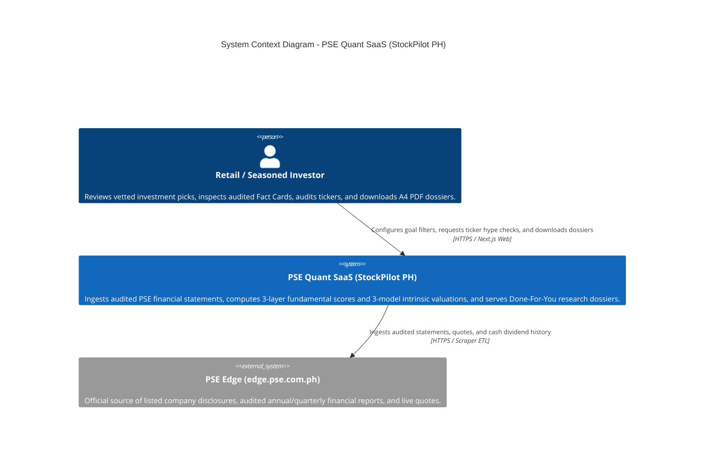
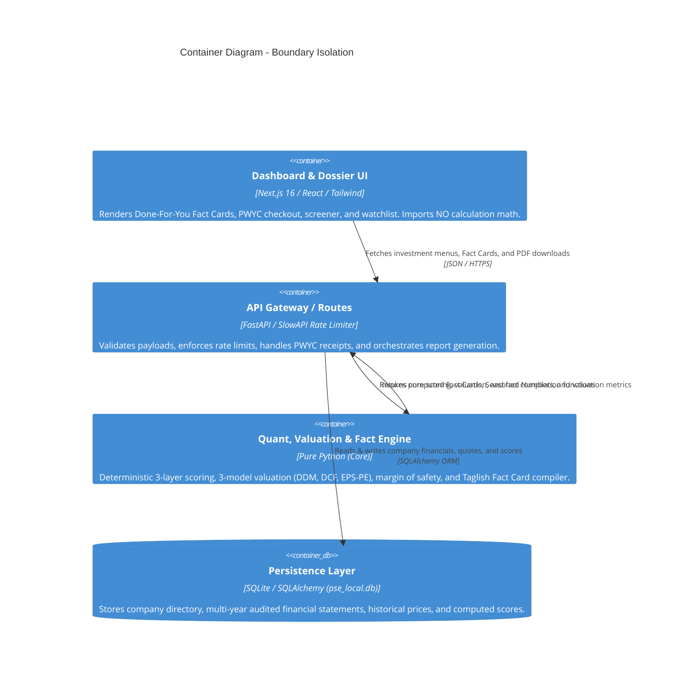
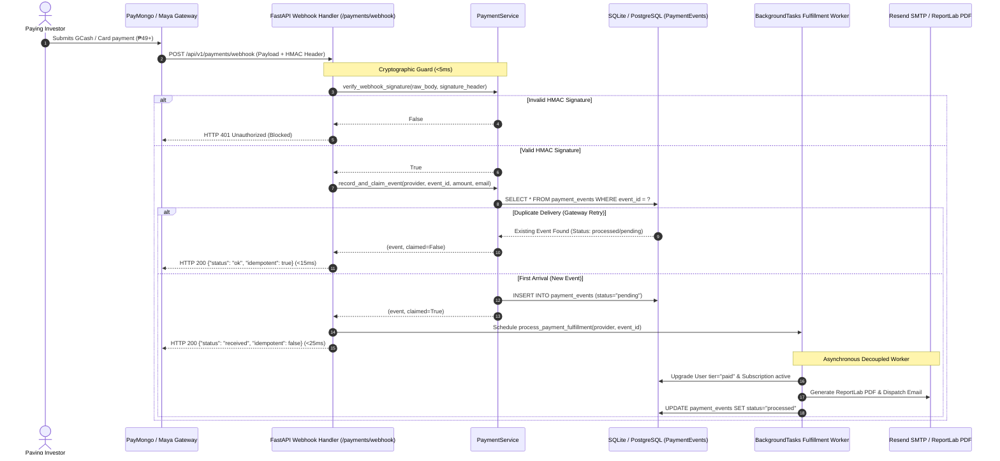

# PSE Quant SaaS — System Map (C4 Architecture)

## Level 1: System Context
The high-level relationship between the investor, the StockPilot PH SaaS system, and external financial data sources.

---

## Level 2: Container Diagram (Boundary Isolation)
Enforces strict decoupling between presentation, transport, computation, and storage.

---

## Level 3: Asynchronous Payment Webhook & Idempotency Sequence

Demonstrates the sub-50ms Fast-ACK boundary and asynchronous background fulfillment worker.

---

## Level 4: Multi-Tier Token Bucket Rate Limiting Architecture

Eliminates the fixed-window boundary burst problem by tracking continuous token replenishment $\Delta t \times r$ bounded by burst capacity $C$.

