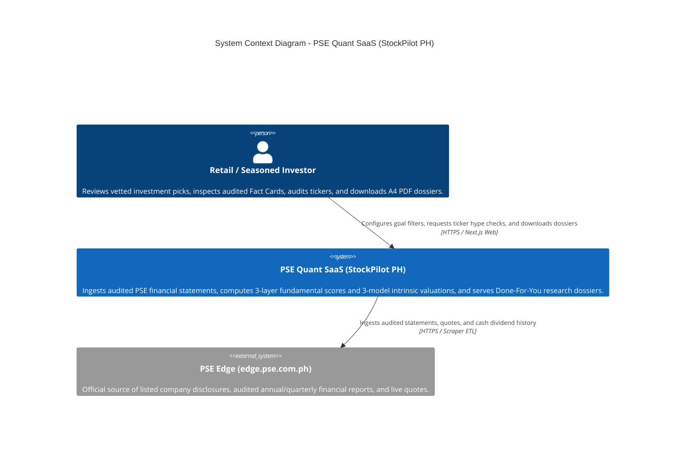
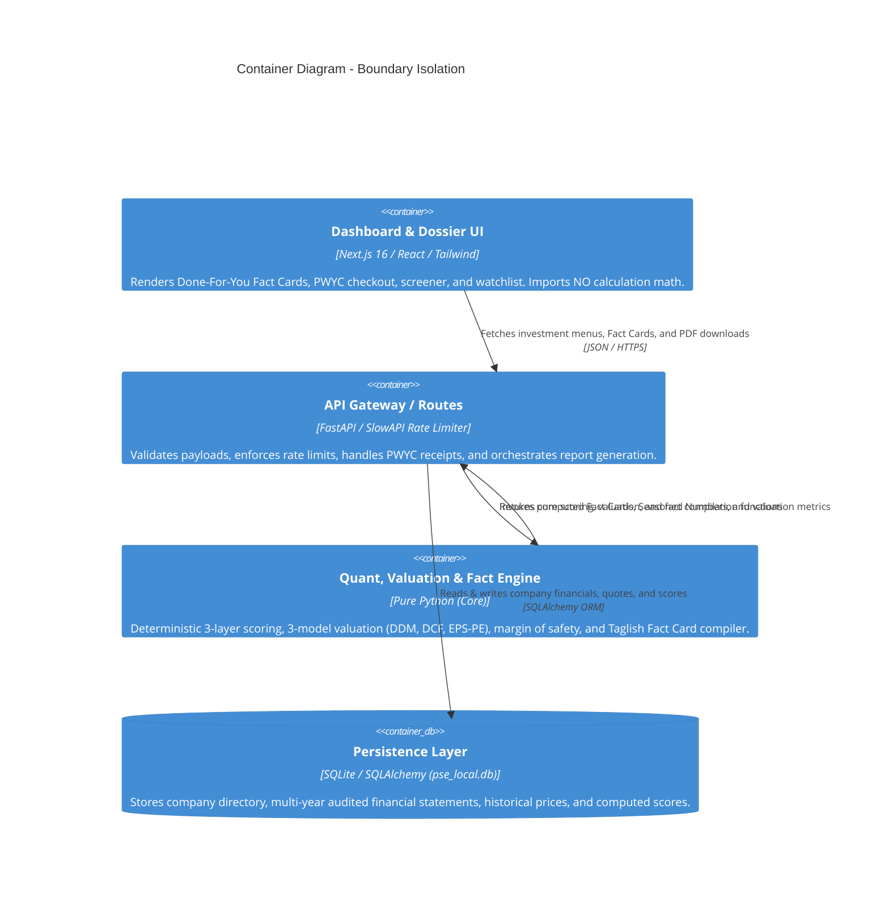
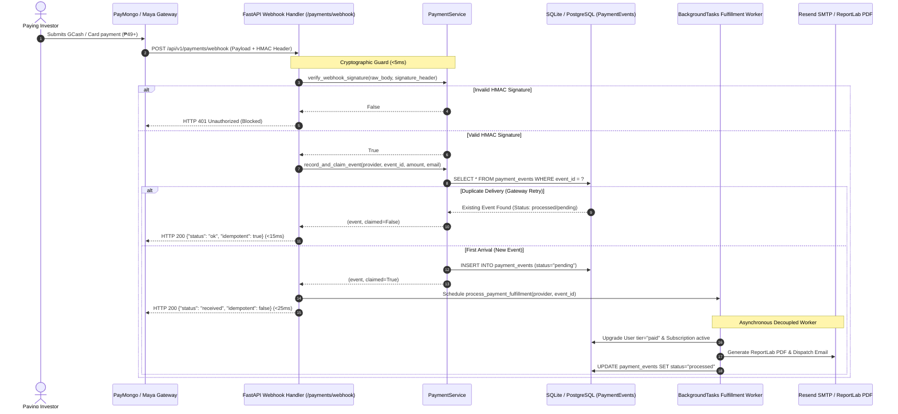
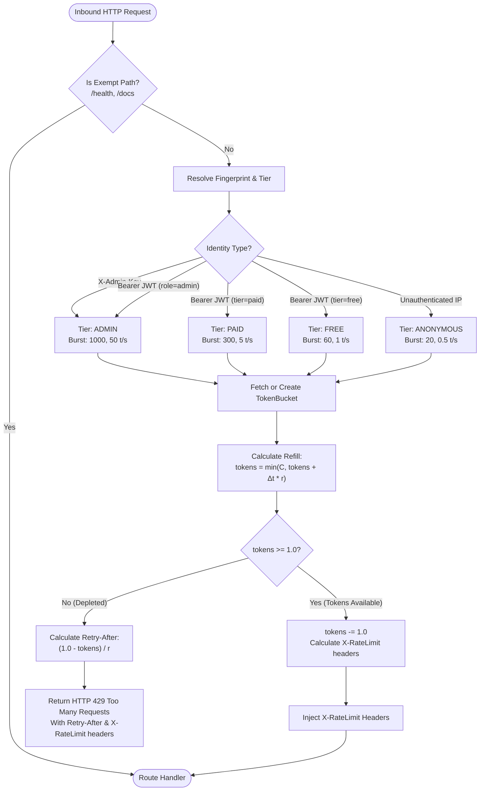
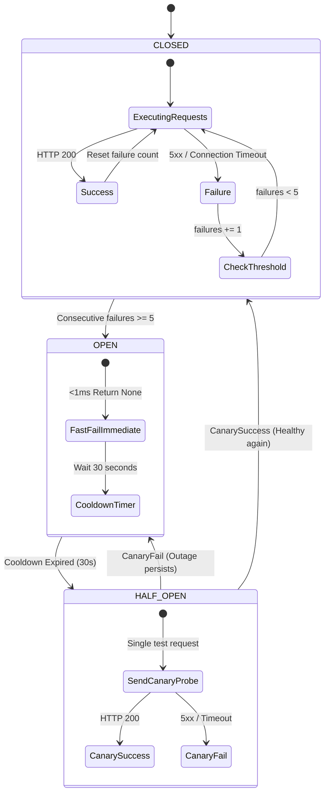
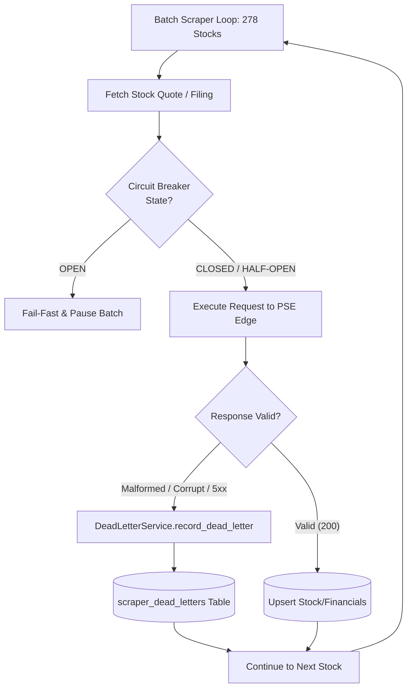
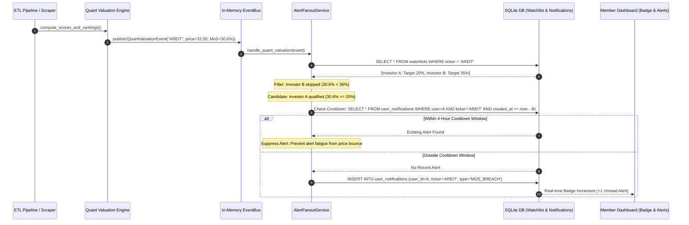
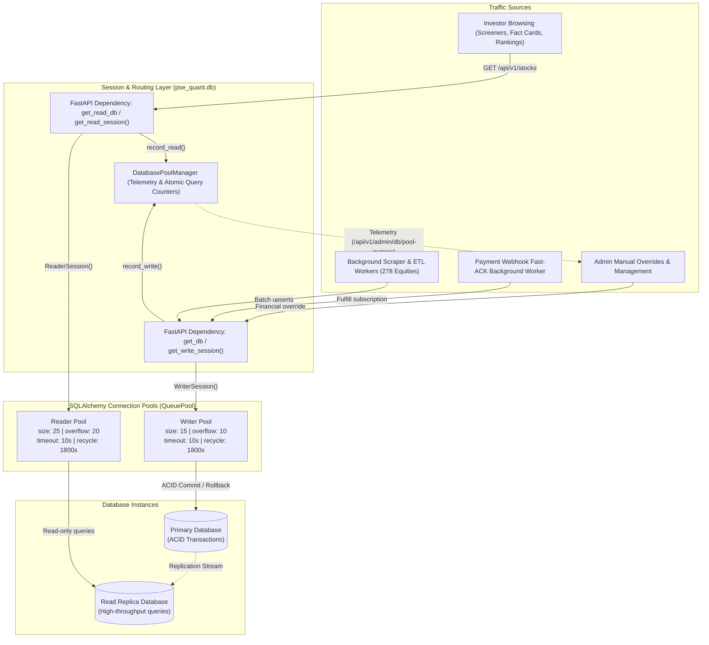
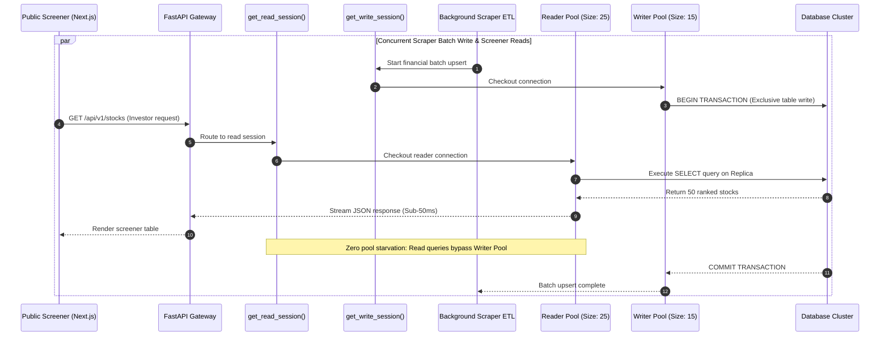

# PSE Quant SaaS — System Map (C4 Architecture)

## Level 1: System Context
The high-level relationship between the investor, the StockPilot PH SaaS system, and external financial data sources.



---

## Level 2: Container Diagram (Boundary Isolation)
Enforces strict decoupling between presentation, transport, computation, and storage.



---

## Level 3: Asynchronous Payment Webhook & Idempotency Sequence

Demonstrates the sub-50ms Fast-ACK boundary and asynchronous background fulfillment worker.



---

## Level 4: Multi-Tier Token Bucket Rate Limiting Architecture

Eliminates the fixed-window boundary burst problem by tracking continuous token replenishment $\Delta t \times r$ bounded by burst capacity $C$.




---

## Level 5: Scraper ETL Circuit Breaker State Machine & Dead-Letter Flow

Protects the quant engine from cascading halts caused by upstream PSE Edge timeouts and isolates malformed corporate filings into durable dead-letter storage.






---

## Level 6: Cache-Aside Architecture & Single-Flight Mutex Sequence

Eliminates redundant database queries and quant recalculations on read endpoints while guaranteeing single-flight origin fetching under concurrent cache stampedes.

```mermaid
sequenceDiagram
    autonumber
    actor InvestorA as Investor Client A
    actor InvestorB as Investor Client B
    participant API as FastAPI Gateway
    participant Cache as CacheEngine (L1 Memory)
    participant Lock as Key-Specific Mutex Lock
    participant DB as SQLite DB & Quant Engine

    InvestorA->>API: GET /api/v1/stocks/AREIT
    InvestorB->>API: GET /api/v1/stocks/AREIT (Simultaneous)
    
    API->>Cache: get("stock:profile:AREIT")
    alt Cache Hit (Common Path)
        Cache-->>API: Return Cached Profile (<0.1ms)
        API-->>InvestorA: HTTP 200 (Instant Response)
    else Cache Miss (Stampede Prevention)
        Cache-->>API: None (Miss)
        API->>Lock: Acquire Lock("stock:profile:AREIT")
        Note over InvestorA,Lock: Investor A acquires lock; Investor B blocks waiting
        API->>Cache: Double-Check get("stock:profile:AREIT")
        alt Populated by predecessor
            Cache-->>API: Return Value
        else Still Miss
            API->>DB: SELECT * FROM stocks, prices, financials WHERE ticker='AREIT'
            DB-->>API: Raw Statement Rows
            API->>API: enrich_stock_valuation() [Quant Math]
            API->>Cache: set("stock:profile:AREIT", profile, TTL=300s + Jitter)
        end
        Lock-->>API: Release Lock
        Note over InvestorB,Lock: Investor B acquires lock, finds cached entry, exits in <0.1ms
        API-->>InvestorA: HTTP 200
        API-->>InvestorB: HTTP 200
    end
```


---

## Level 7: Event-Driven Alert Fanout & Deduplication Cooldown Sequence

Decouples quant scoring calculation from notification channels via an in-memory Pub-Sub Event Bus and suppresses alert storms through a 4-hour deduplication window.




---

## Level 8: Database Read Replicas & Connection Pool Tuning Architecture



### Connection Pool Lifecycle & Contention Isolation Flow


